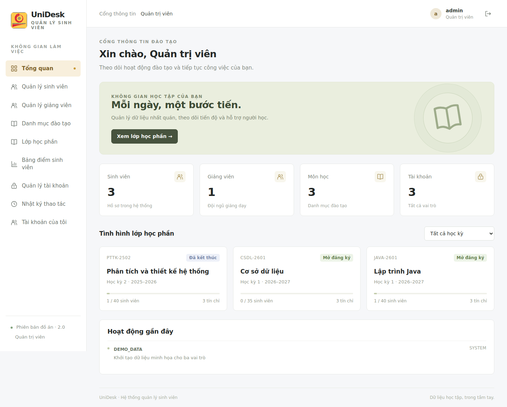
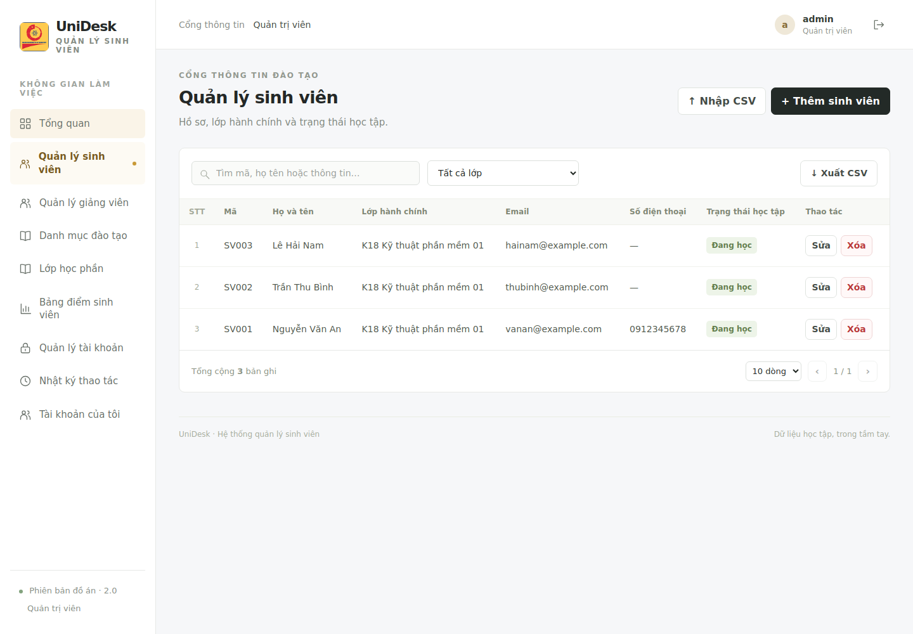

# Hướng dẫn chạy trên Windows

## 1. Chuẩn bị và giải nén

Giải nén toàn bộ ZIP, ví dụ thành `D:\student-manager-v2`. Không mở chương trình từ bên trong cửa sổ ZIP. Giữ nguyên cấu trúc các thư mục.

Mở PowerShell và kiểm tra:

```powershell
java -version
```

Bản chạy sẵn cần Java 17 trở lên. Dự án được biên dịch với mức tương thích Java 17; JDK 21 là lựa chọn phù hợp khi phát triển. Nếu máy đang dùng Java 24 và chạy được bản JAR, không cần cài thêm chỉ để chạy thử. Nếu lệnh không được nhận diện, kiểm tra JAVA_HOME và PATH, rồi mở lại terminal.

## 2. Chạy ngay bằng một tệp

Nhấp đúp `CHAY-UNG-DUNG.cmd`. Đợi xuất hiện `Started Application`, rồi mở:

**http://localhost:8081**

Giữ cửa sổ lệnh mở. Đăng nhập bằng tài khoản trong README. Dùng cửa sổ ẩn danh hoặc trình duyệt khác để kiểm tra một vai trò khác cùng lúc; các tab cùng hồ sơ trình duyệt chia sẻ phiên.

Bản chạy nhanh dùng H2 dạng tệp, tự tạo database và dữ liệu mẫu; chưa cần bật MySQL. Dữ liệu lưu tại `backend\data`, còn nguyên sau khi tắt/mở ứng dụng. Không xóa thư mục này nếu cần giữ dữ liệu.

Dừng bằng Ctrl+C. Không chạy hai backend đồng thời với cùng tệp H2. Nếu cổng 8081 bận, dừng phiên UniDesk cũ hoặc mở PowerShell tại thư mục backend và chạy:

```powershell
java -jar ..\release\student-manager-2.0.0.jar --spring.profiles.active=demo --server.port=8082
```

Sau đó truy cập http://localhost:8082.

## 3. Chạy với MySQL

H2 và MySQL là hai nguồn dữ liệu riêng. Chuyển cấu hình không tự chuyển dữ liệu đã nhập từ nguồn này sang nguồn kia.

1. Bật dịch vụ MySQL 8.x và mở MySQL Workbench.
2. Mở `database\TAO-DATABASE.sql`, thay `CHOOSE_A_NEW_PASSWORD` bằng mật khẩu bạn chọn, rồi chạy bằng tài khoản quản trị MySQL. Không dùng database của dự án cũ.
3. Mở PowerShell tại thư mục dự án:

```powershell
Set-Location D:\student-manager-v2
powershell.exe -NoProfile -ExecutionPolicy Bypass -File .\CHAY-MYSQL.ps1
```

Lệnh trên chỉ cho phép chạy tệp script trong tiến trình PowerShell đó; không thay chính sách của máy. Bạn cũng có thể chạy thủ công các lệnh dưới đây.

4. Nhập tên tài khoản MySQL `student_v2` và mật khẩu đã chọn.
5. Với database mới, nhập `YES` khi được hỏi tạo dữ liệu mẫu. Flyway tự tạo bảng; không import thêm migration bằng tay.
6. Đợi backend khởi động và mở http://localhost:8081.

Cách chạy thủ công, không dùng script:

```powershell
Set-Location D:\student-manager-v2\backend
$env:DB_USERNAME = "student_v2"
$dbSecret = Read-Host "Mat khau MySQL" -AsSecureString
$env:DB_PASSWORD = [System.Net.NetworkCredential]::new("", $dbSecret).Password
$env:DB_URL = "jdbc:mysql://localhost:3306/student_manager_v2?useUnicode=true&characterEncoding=UTF-8&serverTimezone=Asia/Ho_Chi_Minh"
$env:APP_SEED = "true"
java -jar ..\release\student-manager-2.0.0.jar --spring.profiles.active=mysql --server.port=8081
```

`APP_SEED=true` chỉ khởi tạo mẫu khi bảng users trống. Sau lần đầu, có thể đặt false. Đừng tự xóa users để khởi tạo lại trên database đang có dữ liệu.

Chế độ mặc định chỉ lắng nghe trên máy đang chạy (`127.0.0.1`). Triển khai Internet cần cấu hình HTTPS, cookie bảo mật, tài khoản riêng, giới hạn thử đăng nhập và quy trình vận hành. Bản này phục vụ phát triển và demo đồ án trên máy.

## 4. Mở và sửa mã nguồn

### Backend trong IntelliJ

Mở `backend\pom.xml` bằng IntelliJ và chọn Open as Project. Chọn JDK phù hợp trong Project SDK, chờ Maven tải thư viện. Chạy lớp `vn.studentmanager.Application`.

Mặc định backend chạy cổng 8080, dùng profile demo. Trong Run Configuration, đặt Working directory là thư mục backend để dùng cùng vị trí `backend\data`. Dừng bản JAR trước để tránh khóa tệp H2.

Muốn dùng MySQL trong IntelliJ: đặt active profile `mysql`, khai báo DB_USERNAME, DB_PASSWORD, DB_URL và APP_SEED trong Run Configuration. Không ghi mật khẩu vào mã nguồn.

### Frontend trong VS Code

Cần Node.js từ 20.19 trở lên; có thể dùng Node 22 hoặc 24. Mở thư mục frontend bằng VS Code rồi chạy PowerShell:

```powershell
Set-Location D:\student-manager-v2\frontend
npm.cmd ci
npm.cmd run dev
```

Mở **http://localhost:5173**. Vite chuyển `/api` tới backend cổng 8080. Giữ cả hai tiến trình chạy. Nếu backend đang chạy cổng 8081, dừng bản JAR và chạy backend cổng 8080, hoặc sửa target trong `frontend\vite.config.js` cho đúng.

## 5. Build lại sau khi sửa

Dừng bản JAR đang chạy, nhấp đúp `BUILD-LAI.cmd`. Script sẽ:

1. Cài đúng phiên bản frontend theo package-lock.json.
2. Build React và chép vào tài nguyên tĩnh của backend.
3. Chạy `mvnw.cmd clean verify`, gồm các kiểm thử tự động.
4. Cập nhật JAR trong thư mục release.

Cần mạng ở lần build đầu để tải npm/Maven. Khi báo thành công, chạy lại `CHAY-UNG-DUNG.cmd`. Nếu build lỗi, giữ nguyên thông báo để sửa; không bỏ qua kiểm thử.

Chạy kiểm thử backend riêng:

```powershell
Set-Location D:\student-manager-v2\backend
.\mvnw.cmd test
```

Kiểm thử dùng H2 trong bộ nhớ riêng và không đụng database đang chạy của bạn. Backend dùng Spring JDBC với câu SQL có tham số; không sử dụng JPA trong phiên bản mới này.

## 6. Nhập/xuất CSV với Excel

- Trang Quản lý sinh viên → Nhập CSV → Tải CSV mẫu.
- Giữ tiêu đề cột, lưu định dạng CSV UTF-8, dấu phẩy phân cách.
- `class_id` phải là ID lớp có thật. Xem ID bằng API `/api/admin/catalog/classes` khi đang đăng nhập ADMIN, hoặc cột ID trong trang danh mục lớp.
- Ngày theo `yyyy-mm-dd`; giới tính MALE/FEMALE/OTHER; trạng thái STUDYING/PAUSED/LEFT/GRADUATED.
- Mỗi lần nhập tối đa 200 dòng. Một dòng lỗi thì toàn bộ lần nhập được hoàn tác, không tạo dữ liệu dở dang.
- Mật khẩu ban đầu dùng chung cho đợt nhập chỉ để cấp lần đầu; từng người dùng bắt buộc đổi trước khi sử dụng.
- Nút Xuất CSV xuất các dòng khớp tìm kiếm/bộ lọc, không chỉ trang đang nhìn thấy.
- Không hỗ trợ trực tiếp tệp `.xlsx`; hãy lưu thành CSV UTF-8 trước khi nhập.

## 7. Sao lưu và phục hồi

H2: dừng ứng dụng hoàn toàn rồi sao chép cả thư mục `backend\data` tới nơi lưu trữ khác. Khi phục hồi, dừng ứng dụng, sao lưu dữ liệu hiện tại và thay bằng bản đã lưu. Giữ bản dữ liệu và phiên bản mã nguồn tương ứng.

MySQL: dùng Data Export của MySQL Workbench để xuất `student_manager_v2` gồm cấu trúc và dữ liệu. Khi thử phục hồi, nhập vào một database trống riêng rồi đổi DB_URL để kiểm tra. Bản xuất phải gồm bảng `flyway_schema_history`. Không chép trực tiếp các tệp vật lý của MySQL đang chạy.

## 8. Lỗi thường gặp

| Hiện tượng | Cách xử lý |
|---|---|
| `java` không được nhận diện | Kiểm tra cài đặt Java, JAVA_HOME, PATH; mở terminal mới |
| `Port 8081 was already in use` | Dừng phiên cũ hoặc chạy cổng khác |
| `Database may be already in use` | Đang có hai backend mở cùng H2; dừng một bản |
| `Access denied for user` | Kiểm tra user/mật khẩu MySQL, không dùng mật khẩu ADMIN website |
| `Unknown database` | Chạy script tạo database riêng trước |
| Frontend không lấy được dữ liệu | Kiểm tra backend8080 và proxy trong vite.config.js |
| CSV lỗi | Kiểm tra UTF-8, dấu phẩy, mã trùng, class_id và ngày |
| Đăng nhập mẫu không được sau khi đổi mật khẩu | Dùng mật khẩu mới; khởi động lại không đặt lại mật khẩu |
| Bị đưa về đăng nhập | Phiên hết hạn, bị khóa/xóa tài khoản hoặc mật khẩu đã đổi |

Giao diện phát triển không yêu cầu mở cổng 8080 trực tiếp trên trình duyệt; hãy mở 5173. Bản đóng gói dùng chung backend và giao diện ở 8081.

## 9. Ảnh giao diện thực tế




